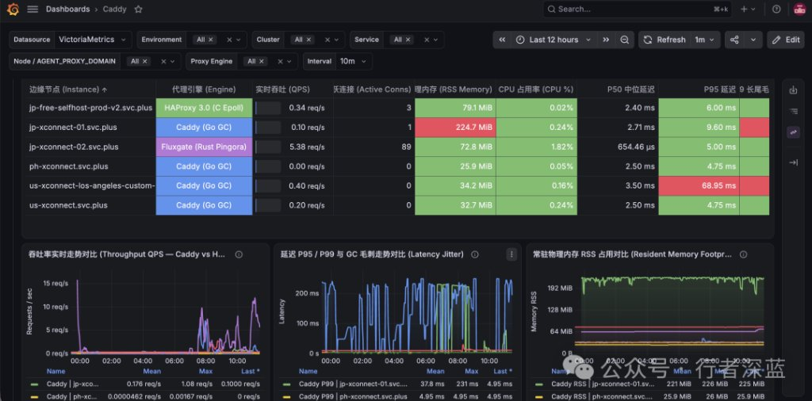
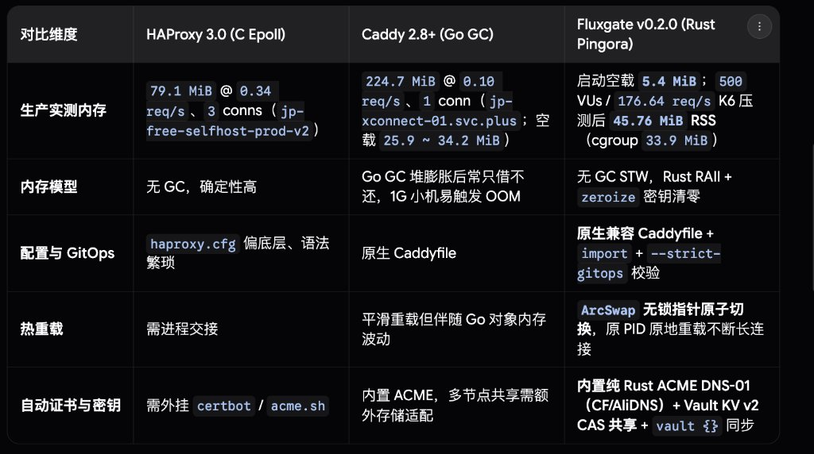

**English** | [简体中文](README.zh-CN.md)

# Fluxgate 🦀

[](https://github.com/ai-workspace-xstream/fluxgate/actions)
[](https://www.rust-lang.org/)
[](https://github.com/cloudflare/pingora)
[](https://caddyserver.com/)
[](LICENSE)

> **A lightweight, zero-GC-bloat edge reverse proxy built for high-concurrency streaming.**  
> Powered by **Rust + Cloudflare Pingora** with native **Caddyfile declarative DSL** compatibility.


---

## 📖 Origin Story: From Go GC OOMs to a Purpose-Built Gateway

Anyone running services on budget 1 vCPU / 1 GB RAM overseas VPS nodes has seen this dreaded kernel alert:
> `kernel: Out of memory: Killed process (caddy), rss: 225MB`

In large, well-provisioned clusters, a few dozen megabytes of memory go unnoticed. On a 1 GB edge node, however, after subtracting OS baseline overhead and backend processes, the safe memory budget left for a reverse proxy is razor-thin. **Here, every megabyte of Resident Set Size (RSS) is a matter of survival.**

* **Caddy's Sweet & Bitter Pill**: Caddyfile syntax is effortless, yet under sustained high-throughput streaming, the Go Runtime's memory allocator and GC favor throughput over return-to-OS—RSS climbs to **240MB+** and keeps the host teetering on the edge of OOM kills, while client disconnects flood logs with false-positive `Client closed H2` alerts.
* **HAProxy's Compromise**: Pure-C HAProxy 3.0 keeps memory disciplined (~64MB), but its verbose, arcane `haproxy.cfg` syntax turns routine maintenance into a chore.
* **Awakening in the AI Era**: **"Reinventing the wheel? It's just streaming CRUD at the network layer."** With sufficient context, enough tokens, and careful engineering around compilation and memory lifecycles, building a high-availability, high-performance gateway on Cloudflare's open-source Rust Pingora—combining Rust RAII zero-runtime overhead with Caddyfile compatibility—is no longer exclusive to hyperscalers.

---

## 📊 Production Benchmarks: Proof Under Real Load

> **Engineering truth: Talking about memory without load is meaningless.**

The dashboard below captures live production traffic across multiple 1 vCPU / 1 GB RAM overseas edge nodes in Grafana:



### Production Baseline Metrics

| Edge Node (Instance) | Proxy Engine | Live Throughput (QPS) | Active Conns | RSS Memory | CPU Usage | Status & Behavior |
| :--- | :--- | :--- | :--- | :--- | :--- | :--- |
| `jp-free-selfhost-prod-v2` | **HAProxy 3.0** (C Epoll) | 0.34 req/s | 3 | **79.1 MiB** | 0.02% | Stable memory, but verbose and arcane config |
| `jp-xconnect-01.svc.plus` | **Caddy 2.8+** (Go GC) | 0.10 req/s | 1 | **224.7 MiB** (Red Alert) | 0.24% | **Retains Go heap after load spikes; near OOM kill** |
| `jp-xconnect-02.svc.plus` | **Fluxgate 0.1.0** (Rust Pingora) | **5.38 ~ 6.59 req/s** | **89 ~ 101 conns** | **72.8 MiB** (All Green) | 1.82% | **Rock-solid RSS under ~100x throughput and ~100 active streams** |
| `ph-xconnect.svc.plus` | Caddy (Go GC) | 0.00 req/s | 0 | 25.9 MiB | 0.05% | Dedicated low-traffic node (all engines look tame at idle) |
| `us-xconnect-los-angeles` | Caddy (Go GC) | 0.40 req/s | 0 | 34.2 MiB | 0.16% | Dedicated low-traffic node (all engines look tame at idle) |
| `us-xconnect.svc.plus` | Caddy (Go GC) | 0.20 req/s | 0 | 32.7 MiB | 0.24% | Dedicated low-traffic node (all engines look tame at idle) |

### Key Takeaways
1. **No Difference at Idle**: On zero-throughput nodes, Caddy sits comfortably at 25–34 MiB.
2. **Load Separates the Field**: Once real high-throughput long-lived streams hit, Caddy's Go Runtime heap stays bloated at **225 MB+**; meanwhile, **Fluxgate holds 101 active long-lived connections at >60x throughput in just 72.8 MiB RSS** (cold startup idle: **5.1 MiB** in v0.1.0, **5.4 MiB** in v0.2.0), eliminating 1 GB VPS OOM anxiety.

### HAProxy 3 vs Caddy 2.x vs Fluxgate v0.2.0



| Dimension | HAProxy 3.0 (C Epoll) | Caddy 2.8+ (Go GC) | Fluxgate v0.2.0 (Rust Pingora) |
| :--- | :--- | :--- | :--- |
| **Memory Footprint** | `79.1 MiB` @ `0.34 req/s` / `3` conns (`jp-free-selfhost-prod-v2`) | `224.7 MiB` @ `0.10 req/s` / `1` conn (`jp-xconnect-01.svc.plus`; idle `25.9 ~ 34.2 MiB`) | `5.4 MiB` startup idle (`5.1 MiB` v0.1.0 idle); `45.76 MiB` RSS (systemd cgroup `33.9 MiB`, peak `34.2 MiB`) after `500` VUs / `176.64 req/s` (`100.00%` avail, `P95 264.37 ms`) on `ph-xconnect.svc.plus` |
| **Runtime & GC** | Deterministic C epoll, no GC | Go GC heap retention near 1 GB OOM | Zero GC STW + Rust RAII + `zeroize` |
| **Configuration DSL** | Verbose `haproxy.cfg` | Native Caddyfile | Native Caddyfile + `import` + `--strict-gitops` |
| **Config Reload** | Process handoff on reload | Graceful reload with Go memory spikes | `ArcSwap` lock-free atomic reload (same PID, zero dropped streams) |
| **TLS / ACME & Multi-Node** | Requires external `certbot` / `acme.sh` | Built-in ACME (multi-node requires external storage adapter) | Built-in pure-Rust ACME DNS-01 (`cloudflare` / `alidns`) + Vault KV v2 CAS multi-node cert sharing + `vault {}` sync |

### `v0.2.0` K6 Stress Test & Resource Usage (macOS Local Client)

All K6 benchmarks below were executed from a **macOS local client** (`localhost` temporary Xray client + Docker `grafana/k6:1.7.1`) over real cross-border WAN links.

#### Group A: `500` VUs Extreme Stress Test

| Node | Engine & Spec | Workload (VUs / QPS) | Availability & P95 | Pre-Load Memory | Post-Load Memory (RSS / systemd cgroup) | Active TCP Conns |
| :--- | :--- | :--- | :--- | :--- | :--- | :---: |
| `ph-xconnect.svc.plus` | **Fluxgate v0.2.0** (Rust Pingora) | `500` VUs / `176.64 req/s` (`42,551` reqs) | **`100.00%`**, **`264.37 ms`** (**PASS**) | `5.4 MiB` (peak `7.0 MiB`) | **`45.76 MiB`** RSS (cgroup **`33.9 MiB`**, peak `34.2 MiB`) | — |
| `jp-xconnect-free-01.svc.plus` | **Fluxgate v0.2.0** (`1 vCPU / 967 MiB`) | `500` VUs / **`118.79 req/s`** (`28,905` reqs) | **`99.94%`**, `1773.19 ms` | `97.9 MiB` RSS (cgroup `93.3 MiB`) | **`105.3 MiB`** RSS (cgroup **`102.1 MiB`**, peak `102.5 MiB`) | `149 -> 1083` |
| `jp-xconnect-01.svc.plus` | **HAProxy 3.0.11** (`1,936 MiB` RAM) | `500` VUs / **`147.04 req/s`** (`35,511` reqs) | **`100.00%`**, **`1079.42 ms`** (**PASS**) | `117.4 MiB` RSS (cgroup `131.1 MiB`) | **`118.3 MiB`** RSS (cgroup `141.4 MiB`, peak `156.2 MiB`) | `313 -> 1841` |
| `us-xconnect.svc.plus` | **Caddy v2.11.4** (`1 vCPU / 961 MiB`) | `500` VUs / `111.01 req/s` (`27,407` reqs) | **`99.95%`**, `1833.13 ms` | `41.2 MiB` RSS (cgroup `47.2 MiB`) | **`171.4 MiB`** RSS (cgroup **`177.8 MiB`**, peak `248.7 MiB`, swap `13.8 MiB`) | `38 -> 1019` |

#### Group B: `40` VUs Availability Benchmark

| Node | Engine & Spec | Workload (VUs / QPS) | Availability & P95 | Post-Load Memory (RSS / systemd cgroup) | Active TCP Conns |
| :--- | :--- | :--- | :--- | :--- | :---: |
| `jp-xconnect-free-01.svc.plus` | **Fluxgate v0.2.0** (`1 vCPU / 967 MiB`) | `40` VUs / `10.92 req/s` (`715` reqs) | **`99.72%`**, `2661.48 ms` (`P50 691.50 ms`) | **`34.3 MiB`** RSS (cgroup **`22.1 MiB`**, peak `22.3 MiB`) | `261` |
| `jp-xconnect-01.svc.plus` | **HAProxy 3.0.11** (`1,936 MiB` RAM) | `40` VUs / `14.67 req/s` (`909` reqs) | **`100.00%`**, `2136.90 ms` (`P50 440.58 ms`) | `116.3 MiB` RSS (cgroup `126.8 MiB`, peak `156.2 MiB`) | `322` |
| `us-xconnect.svc.plus` | **Caddy v2.11.4** (`1 vCPU / 961 MiB`) | `40` VUs / `9.35 req/s` (`623` reqs) | `99.52%`, `2466.05 ms` (`P50 633.87 ms`) | `52.8 MiB` RSS (cgroup `58.8 MiB`, peak `248.7 MiB`, swap `13.9 MiB`) | `113` |

> **Observed Resource Behavior**: On the same `1 vCPU / ~960 MiB` class under `40` VUs, **Fluxgate v0.2.0** used only **`22.1 MiB` cgroup (`34.3 MiB` RSS, peak `22.3 MiB`)**, and under a `500`-VU blast (`118.79 req/s`, `99.94%` avail) its RSS grew by just `+7.4 MiB` (`97.9 -> 105.3 MiB` RSS / `102.1 MiB` cgroup). By contrast, **Caddy v2.11.4** (`111.01 req/s`, `99.95%` avail) jumped `+130.2 MiB` (**4.16x**) from `41.2 MiB` to **`171.4 MiB` RSS (`177.8 MiB` cgroup, peak `248.7 MiB`, swap `13.8 MiB`)**. **HAProxy 3.0.11** stayed rock-solid at **`118.3 MiB` RSS (`141.4 MiB` cgroup)** across `1,841` established connections (`147.04 req/s`, `100.00%` avail, `P95 1079.42 ms`).

---

## ⚡ Core Architecture & Features

- **Cloudflare Pingora Industrial Foundation (`pingora 0.9.1`)**: Multi-threaded async Tokio runtime with strict Rust RAII memory lifecycle management, zero GC stop-the-world pauses, and no memory spikes.
- **100% Core Caddyfile Syntax Compatibility**: Reuse your clean, familiar Caddyfile with zero learning curve and zero migration friction.
- **Native `h2c` over Unix Domain Socket**: Explicitly preserves HTTP/2 cleartext prior-knowledge forwarding to local UDS (e.g., `/dev/shm/xray.sock`), preventing implicit fallback to HTTP/1.1.
- **Clean Logs • Source-Level 499 Noise Reduction**: Intercepts downstream client-initiated `RST_STREAM` / `stream no longer needed` cancellations and maps them cleanly to HTTP 499, silencing false-alarm log floods.
- **Zero-Buffer Streaming Pipeline**: Streams bidirectional body payloads directly with a default 1 MB HTTP/2 flow-control window and disables unsafe automatic retries.
- **v0.2.0 Production Control Plane Enhancements** (see [v0.2.0 Roadmap](docs/roadmap-v0.2.0.md) and [CHANGELOG](CHANGELOG.md)):
  - **Vault KV v2 Secure Sync**: In-memory `SecretStore` (`zeroize` on drop + redacted logging), supporting AppRole / Token / systemd `LoadCredential` and `{vault.<alias>.<key>}` dynamic injection.
  - **Zero-Downtime GitOps Hot Reload**: Works with Ansible Pull for non-sensitive declarations, `import` composition, `fluxgate reload` (`ArcSwap` atomic swap), and `--strict-gitops` secret gating.
  - **Pure-Rust ACME DNS-01 Auto-Renewal**: Native `cloudflare` and `alidns` providers, dynamic SNI hot-swap via Pingora `TlsAccept`, and **Vault KV CAS multi-node certificate sharing**.

---

## 🛠️ Quick Start

### CLI Usage

```bash
# Validate configuration syntax (with friendly errors and line numbers)
fluxgate validate --config /etc/fluxgate/Fluxgatefile

# Strict GitOps offline gate (rejects plaintext private keys/tokens)
fluxgate validate --strict-gitops --offline --config /etc/fluxgate/Fluxgatefile

# Start the reverse proxy
fluxgate run --config /etc/fluxgate/Fluxgatefile

# Zero-downtime hot reload (sends SIGHUP to the running process)
fluxgate reload

# Diagnose config, Vault connectivity, and certificate expiration
fluxgate doctor --config /etc/fluxgate/Fluxgatefile

# Check version
fluxgate version
```

### Configuration Example (`Fluxgatefile`)

Fluxgate natively supports core Caddyfile DSL—write it the same way you always have:

```caddy
{
    grace_period 15s
    log {
        level INFO
    }
}

import /etc/fluxgate/conf.d/*.conf
```

Site sub-config example (`conf.d/jp-xconnect-02.conf`):

```caddy
jp-xconnect-02.svc.plus {
    tls /etc/fluxgate/tls/server.crt /etc/fluxgate/tls/server.key

    @stream {
        path /split /split/*
    }
    rewrite @stream /split/

    handle @stream {
        uri query -x_padding

        reverse_proxy unix//dev/shm/xray.sock {
            flush_interval -1
            transport http {
                versions h2c 2
            }
        }
    }

    handle_path /exporter/* {
        reverse_proxy 127.0.0.1:8080
    }

    respond "Fluxgate Edge Node Ready" 200
}
```

---

## 📋 Caddyfile Compatibility Matrix

Fluxgate focuses strictly on high-frequency core DSL directives without bloat:

| Directive / Syntax Feature | Support | Notes |
| :--- | :---: | :--- |
| Global block `{ grace_period ...; log { ... } }` | ✅ Supported | Maps to Pingora `grace_period_seconds` and Tokio log filter |
| `import <glob/path>` | ✅ Supported | Supports relative/absolute paths, sorted globs, cycle & depth (`16`) detection |
| Site block `<domain1> <domain2> { ... }` | ✅ Supported | Supports exact domains and wildcard (`*.domain`) matching |
| `tls <cert> <key>` | ✅ Supported | Modern OpenSSL cipher suites with H2 / HTTP/1.1 ALPN negotiation |
| `handle_path <prefix> { ... }` | ✅ Supported | Strips prefix and isolates route handling |
| `@name { path ... }` / `@name path ...` | ✅ Supported | Named path matchers (exact match and `*` wildcard) |
| `handle [@matcher] { ... }` | ✅ Supported | Mutually exclusive route branch executor |
| `rewrite [@matcher] <target>` | ✅ Supported | Internal request path and URI rewrite |
| `uri query -<param>` | ✅ Supported | Dynamically strips specified query parameter while keeping others |
| `reverse_proxy <tcp\|unix//...> { ... }` | ✅ Supported | Supports `flush_interval -1` and `versions h2c 2` zero-copy pipeline |
| `respond "<body>" [status]` | ✅ Supported | High-performance static fallback and health check responses |
| Unknown or unimplemented directives | 🛑 Strictly Rejected | Fails fast at startup/validation with exact line numbers to prevent silent misbehavior |

---

## 🚀 Deployment & Zero-Risk Rollback

Fluxgate is delivered as a static cross-compiled binary—no Rust toolchain is required on production nodes:

```bash
# 1. Validate configuration
fluxgate validate --config /etc/fluxgate/Fluxgatefile

# 2. Switch from Caddy/HAProxy to Fluxgate (existing Caddyfile configs remain untouched)
sudo systemctl disable --now caddy haproxy 2>/dev/null || true
sudo systemctl enable --now fluxgate

# 3. Instant rollback (if an unexpected issue occurs)
sudo systemctl disable --now fluxgate
sudo systemctl enable --now caddy   # or haproxy
```

---

## 🤝 Credits & Open-Source Philosophy

> **"With enough tokens and enough polish, anything is possible."**

- Network engine inspired by [Cloudflare Pingora](https://github.com/cloudflare/pingora).
- Configuration philosophy inspired by [Caddy Server](https://github.com/caddyserver/caddy) and its elegant Caddyfile design.
- Issues, PRs, and real-world optimization stories on lightweight edge servers are always welcome!
