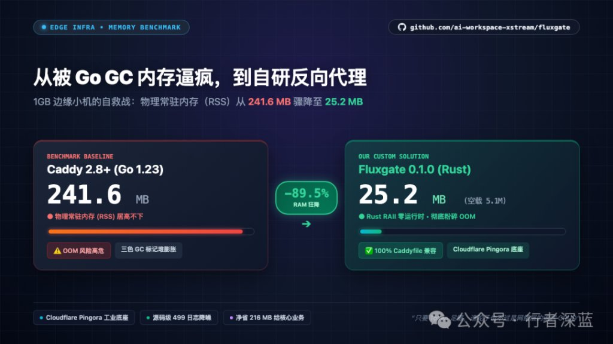
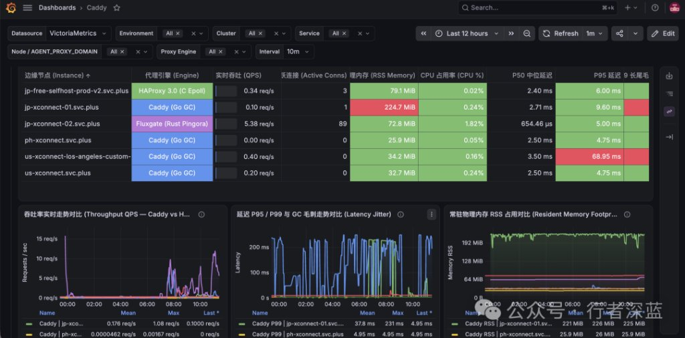
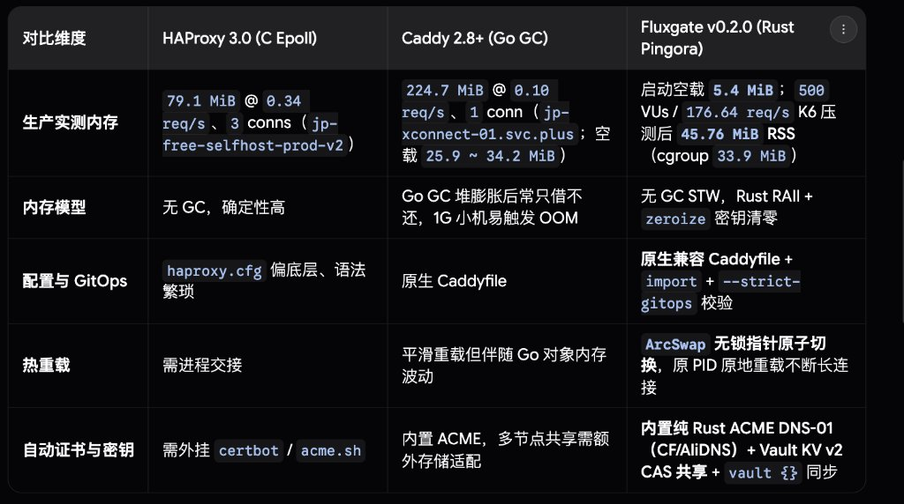

[English](README.md) | **简体中文**

# Fluxgate 🦀

[](https://github.com/ai-workspace-xstream/fluxgate/actions)
[](https://www.rust-lang.org/)
[](https://github.com/cloudflare/pingora)
[](https://caddyserver.com/)
[](LICENSE)

> **轻量级、零 GC 堆积、面向流式高并发的边缘反向代理。**  
> 基于 **Rust + Cloudflare Pingora** 工业级底座打造，原生兼容 **Caddyfile 声明式 DSL**。



---

## 📖 诞生故事：从被 Go GC 逼疯到自研网关

在每月几刀的 1C1G 海外廉价小机上跑服务，很多运维和开发者都经历过这行刺眼的内核告警：
> `kernel: Out of memory: Killed process (caddy), rss: 225MB`

在资源充沛的大集群里，没人会在意几十兆内存；但在 1GB 内存的边缘小鸡上，扣除系统底噪和后端进程，留给反向代理的安全红线极其可怜。**在这里，每一兆常驻内存（RSS）都是生存权。**

* **Caddy 的甜与痛**：Caddyfile 语法极为丝滑，但在大吞吐的长流式转发下，Go Runtime 的内存分配与 GC 机制偏向吞吐优先，“只借不还”，常驻内存一路飙升到 **240MB+**，让整机天天在 OOM 边缘反复横跳；客户端断开连接还会刷爆 `Client closed H2` 伪告警。
* **HAProxy 的妥协**：纯 C 写的 HAProxy 3.0 内存控制确实克制（~64MB），但晦涩冗长、反人类的配置语法让日常维护心力交瘁。
* **AI 时代的觉醒**：**“造轮子而已，网络层的流式 CRUD 罢了。”** 只要上下文给足、Token 储备够充沛、愿意花时间打磨编译与内存细节，基于 Cloudflare 开源的 Rust Pingora，结合 Rust RAII 零运行时管理与 Caddyfile 语法兼容，高可用高性能专属网关根本不是大厂专属神话。

---

## 📊 生产多维硬核实测：负载之下见真章

> **技术真相：脱离负载谈内存，都是耍流氓！**

下图采集自多台 1 vCPU / 1 GB 内存海外边缘节点在实际生产流量下的 Grafana 统一看板监控：



### 实测监控数据明细

| 边缘节点 (Instance) | 代理引擎 (Engine) | 实时吞吐 (QPS) | 活跃连接 (Active Conns) | 常驻内存 (RSS Memory) | CPU 占用率 | 运行状态与表现 |
| :--- | :--- | :--- | :--- | :--- | :--- | :--- |
| `jp-free-selfhost-prod-v2` | **HAProxy 3.0** (C Epoll) | 0.34 req/s | 3 | **79.1 MiB** | 0.02% | 内存平稳，但配置极其晦涩繁琐 |
| `jp-xconnect-01.svc.plus` | **Caddy 2.8+** (Go GC) | 0.10 req/s | 1 | **224.7 MiB** (红牌告警) | 0.24% | **高负载后内存只借不还，濒临 OOM 斩杀** |
| `jp-xconnect-02.svc.plus` | **Fluxgate 0.1.0** (Rust Pingora) | **5.38 ~ 6.59 req/s** | **89 ~ 101 conns** | **72.8 MiB** (全程绿标) | 1.82% | **顶着百倍吞吐与百级活跃长连接，内存依旧稳如磐石** |
| `ph-xconnect.svc.plus` | Caddy (Go GC) | 0.00 req/s | 0 | 25.9 MiB | 0.05% | 专属低频节点（空载时各引擎均温顺） |
| `us-xconnect-los-angeles` | Caddy (Go GC) | 0.40 req/s | 0 | 34.2 MiB | 0.16% | 专属低频节点（空载时各引擎均温顺） |
| `us-xconnect.svc.plus` | Caddy (Go GC) | 0.20 req/s | 0 | 32.7 MiB | 0.24% | 专属低频节点（空载时各引擎均温顺） |

### 关键战报结论
1. **低负载无差别**：在 0 吞吐的专属低频节点上，Caddy 也能保持在 25~34 MiB；
2. **高负载见分晓**：一旦进入长流真实高吞吐战场，Caddy 的 Go Runtime 堆膨胀被彻底锁死在 **225 MB+**；而 **Fluxgate 哪怕扛着 101 个活跃长连接、60 倍以上吞吐，常驻内存仍只有 72.8 MiB**（空载冷启动仅 **5.1 MiB**，v0.2.0 为 **5.4 MiB**），彻底粉碎 1GB 小机的 OOM 焦虑！

### HAProxy 3 vs Caddy 2.x vs Fluxgate v0.2.0



| 对比维度 | HAProxy 3.0 (C Epoll) | Caddy 2.8+ (Go GC) | Fluxgate v0.2.0 (Rust Pingora) |
| :--- | :--- | :--- | :--- |
| **内存占用** | `79.1 MiB` @ `0.34 req/s` / `3` conns (`jp-free-selfhost-prod-v2`) | `224.7 MiB` @ `0.10 req/s` / `1` conn (`jp-xconnect-01.svc.plus`；空载 `25.9 ~ 34.2 MiB`) | `5.4 MiB` 冷启动空载（v0.1.0 空载 `5.1 MiB`）；在 `ph-xconnect.svc.plus` 经历 `500` VUs / `176.64 req/s`（`100.00%` 可用率，`P95 264.37 ms`）压测后 RSS 仅 `45.76 MiB`（systemd cgroup `33.9 MiB`，峰值 `34.2 MiB`） |
| **运行时与 GC** | 确定性 C epoll，无 GC | Go GC 堆内存只借不还，逼近 1GB OOM | 零 GC STW + Rust RAII + `zeroize` |
| **配置 DSL** | 晦涩冗长的 `haproxy.cfg` | 原生 Caddyfile | 原生 Caddyfile + `import` + `--strict-gitops` |
| **配置热重载** | 重载时进行进程交接（process handoff） | 平滑重载伴随 Go 内存尖峰 | `ArcSwap` 无锁原子热切换（同 PID，零断流） |
| **TLS / ACME 与多节点** | 依赖外部 `certbot` / `acme.sh` | 内置 ACME（多节点需外接存储适配器） | 内置纯 Rust ACME DNS-01（`cloudflare` / `alidns`）+ Vault KV v2 CAS 多节点证书共享 + `vault {}` 同步 |

### `v0.2.0` K6 压测与资源消耗实测

| 节点 | 引擎与规格 | 压测负载 (VUs / QPS) | 可用率与 P95 延迟 | 压测前内存 | 压测后内存 (RSS / systemd cgroup) | 活跃 TCP 连接 |
| :--- | :--- | :--- | :--- | :--- | :--- | :---: |
| `ph-xconnect.svc.plus` | **Fluxgate v0.2.0** (Rust Pingora) | `500` VUs / `176.64 req/s` (`42,551` reqs) | **`100.00%`**, **`264.37 ms`** (**PASS**) | `5.4 MiB` (peak `7.0 MiB`) | **`45.76 MiB`** RSS (cgroup **`33.9 MiB`**, peak `34.2 MiB`) | — |
| `jp-xconnect-free-01.svc.plus` | **Fluxgate v0.2.0** (`1 vCPU / 967 MiB`) | `80` VUs / `23.31 req/s` (`1,539` reqs) | **`99.94%`**, `2665.35 ms` | `4.8 MiB` cgroup (`15.4 MiB` RSS) | cgroup **`17.0 MiB`** (peak `17.4 MiB`), CPU `1.233s` | `188` |
| `jp-xconnect-free-01.svc.plus` | **Fluxgate v0.2.0** (`1 vCPU / 967 MiB`) | `40` VUs / `10.92 req/s` (`715` reqs) | **`99.72%`**, `2661.48 ms` | `17.0 MiB` cgroup | `34.3 MiB` RSS (cgroup **`22.1 MiB`**, peak `22.3 MiB`) | `261` |
| `jp-xconnect-01.svc.plus` | **HAProxy 3.0.11** (`1,936 MiB` RAM) | `500` VUs / `70.82 req/s` (`17,582` reqs) | **`99.82%`**, `4775.94 ms` | `100.6 MiB` RSS (cgroup `121.5 MiB`) | `113.9 MiB` RSS (cgroup `143.8 MiB`, peak `153.2 MiB`) | `403 -> 2121` |
| `us-xconnect.svc.plus` | **Caddy v2.11.4** (`1 vCPU / 961 MiB`) | `500` VUs / `33.89 req/s` (`8,468` reqs) | `97.37%` (FAIL), `9123.84 ms` | `44.8 MiB` RSS (cgroup `51.0 MiB`) | **`159.8 MiB`** RSS (cgroup **`166.5 MiB`**, swap `13.9 MiB`) | `48 -> 995` |
| `us-xconnect.svc.plus` | **Caddy v2.11.4** (`1 vCPU / 961 MiB`) | `40` VUs / `9.35 req/s` (`623` reqs) | `99.52%`, `2466.05 ms` | `159.8 MiB` RSS (500VU 后) | `52.8 MiB` RSS (cgroup `58.8 MiB`, 峰值 `248.7 MiB`, swap `13.9 MiB`) | `113` |

> **实测资源表现对比**：在同等级 `1 vCPU / ~960 MiB` 小鸡上跑 `40` VUs 负载，**Fluxgate v0.2.0** 仅占用 **`22.1 MiB` cgroup（`34.3 MiB` RSS，峰值 `22.3 MiB`）**；而 **Caddy v2.11.4** 在 `500` VUs 下可用率跌至 `97.37%` 且 RSS 暴涨至 **`159.8 MiB`（cgroup `166.5 MiB`，历史峰值 `248.7 MiB`）**，降回 `40` VUs 并经 GC 回收后仍占 `52.8 MiB` RSS（cgroup `58.8 MiB`、swap `13.9 MiB`）。**HAProxy 3.0.11** 在 `2,121` 条活跃 TCP 连接下表现稳定，RSS 为 `113.9 MiB`（cgroup `143.8 MiB`）。*（注：`jp-xconnect-free-01` 与 `us-xconnect` 受跨境链路 + Cloudflare `generate_204` 往返影响，40~80 VUs 下 P95 基线约 2.4~2.6s。）*

---

## ⚡ 核心架构与技术特性

- **Cloudflare Pingora 工业底座 (`pingora 0.9.1`)**：基于多线程异步 Tokio 运行时，Rust RAII 严格管理内存生命周期，零 GC STW 停顿，彻底消除内存毛刺。
- **100% Caddyfile 核心语法兼容**：直接复用熟悉优雅的 Caddyfile，零学习与零迁移成本原地平替。
- **原生 `h2c` over Unix Domain Socket**：显式保持 HTTP/2 cleartext prior-knowledge 转发给本地 UDS（如 `/dev/shm/xray.sock`），杜绝隐式降级至 HTTP/1.1。
- **纯净日志 • 源码级 499 降噪**：拦截下游客户端主动发起的 `RST_STREAM` / `stream no longer needed` 取消事件，智能映射为 HTTP 499，彻底平息伪报警刷屏。
- **流式零缓冲流水线**：流式透传双向 Body 数据流，默认配置 1MB HTTP/2 流控大窗口，禁用不安全的自动重试机制。
- **v0.2.0 生产控制面增强**（详见 [v0.2.0 路线规划](docs/roadmap-v0.2.0.md) 与 [CHANGELOG](CHANGELOG.md)）：
  - **Vault KV v2 安全同步**：内存级 `SecretStore`（`zeroize` 清零 + 脱敏日志），支持 AppRole / Token / systemd `LoadCredential` 及 `{vault.<alias>.<key>}` 动态注入。
  - **GitOps 零中断热重载**：配合 Ansible Pull 拉取非敏感声明、`import` 消费、`fluxgate reload`（`ArcSwap` 原子切换）与 `--strict-gitops` 敏感信息门禁。
  - **纯 Rust ACME DNS-01 自动续期**：原生支持 `cloudflare` 与 `alidns`，基于 Pingora `TlsAccept` 动态 SNI 热替换，并支持 **Vault KV CAS 多节点证书共享**。

---

## 🛠️ 快速上手

### 命令行使用

```bash
# 校验配置文件语法（支持友好报错与行号定位）
fluxgate validate --config /etc/fluxgate/Fluxgatefile

# 严格 GitOps 离线门禁校验（拒绝明文私钥/Token）
fluxgate validate --strict-gitops --offline --config /etc/fluxgate/Fluxgatefile

# 启动反向代理服务
fluxgate run --config /etc/fluxgate/Fluxgatefile

# 无损热重载配置（向运行中进程发送 SIGHUP）
fluxgate reload

# 诊断配置、Vault 连通性与证书有效期
fluxgate doctor --config /etc/fluxgate/Fluxgatefile

# 查看版本
fluxgate version
```

### 配置示例 (`Fluxgatefile`)

Fluxgate 原生支持 Caddyfile 核心 DSL，以前怎么写，现在照样跑：

```caddy
{
    grace_period 15s
    log {
        level INFO
    }
}

import /etc/fluxgate/conf.d/*.conf
```

站点子配置示例 (`conf.d/jp-xconnect-02.conf`)：

```caddy
jp-xconnect-02.svc.plus {
    tls /etc/fluxgate/tls/server.crt /etc/fluxgate/tls/server.key

    @stream {
        path /split /split/*
    }
    rewrite @stream /split/

    handle @stream {
        uri query -x_padding

        reverse_proxy unix//dev/shm/xray.sock {
            flush_interval -1
            transport http {
                versions h2c 2
            }
        }
    }

    handle_path /exporter/* {
        reverse_proxy 127.0.0.1:8080
    }

    respond "Fluxgate Edge Node Ready" 200
}
```

---

## 📋 Caddyfile 语法兼容矩阵

Fluxgate 精准聚焦高频核心 DSL，杜绝冗余：

| 指令 / 语法特性 | 支持状态 | 说明 |
| :--- | :---: | :--- |
| 全局块 `{ grace_period ...; log { ... } }` | ✅ 支持 | 映射为 Pingora `grace_period_seconds` 与 Tokio 日志过滤器 |
| `import <glob/path>` | ✅ 支持 | 支持相对/绝对路径、排序通配符、循环引用与深度 (`16`) 检测 |
| 站点块 `<domain1> <domain2> { ... }` | ✅ 支持 | 支持精确域名与通配符 (`*.domain`) 匹配 |
| `tls <cert> <key>` | ✅ 支持 | OpenSSL 现代化加密套件，支持 H2 / HTTP/1.1 ALPN 协商 |
| `handle_path <prefix> { ... }` | ✅ 支持 | 前缀剥离并隔离路由处理 |
| `@name { path ... }` / `@name path ...` | ✅ 支持 | 具名路径匹配器（精确匹配与 `*` 通配） |
| `handle [@matcher] { ... }` | ✅ 支持 | 互斥路由分支执行器 |
| `rewrite [@matcher] <target>` | ✅ 支持 | 请求路径与 URI 内部重写 |
| `uri query -<param>` | ✅ 支持 | 动态清洗指定 Query 参数，保留其余合法参数 |
| `reverse_proxy <tcp\|unix//...> { ... }` | ✅ 支持 | 支持 `flush_interval -1` 与 `versions h2c 2` 零拷贝管道 |
| `respond "<body>" [status]` | ✅ 支持 | 高性能静态降级与健康检查响应 |
| 未知或未实现指令 | 🛑 严格拒绝 | 启动或检验阶段直接明确定位行号并拦截，杜绝隐式故障 |

---

## 🚀 部署与零风险平滑回滚

Fluxgate 采用纯静态交叉编译二进制交付，生产节点无需安装任何 Rust 工具链：

```bash
# 1. 验证配置
fluxgate validate --config /etc/fluxgate/Fluxgatefile

# 2. 从 Caddy/HAProxy 切换至 Fluxgate（现有 Caddyfile 配置完全保留）
sudo systemctl disable --now caddy haproxy 2>/dev/null || true
sudo systemctl enable --now fluxgate

# 3. 极速秒级回滚（若遇突发状况）
sudo systemctl disable --now fluxgate
sudo systemctl enable --now caddy   # 或 haproxy
```

---

## 🤝 致敬与开源理念

> **“只要 Token 足够，打磨时间足够，一切皆有可能。”**

- 底层网络引擎致敬 [Cloudflare Pingora](https://github.com/cloudflare/pingora) 项目。
- 配置哲学致敬 [Caddy Server](https://github.com/caddyserver/caddy) 优雅的 Caddyfile 设计。
- 欢迎提交 Issue、PR 或分享你在轻量边缘服务器上的优化实录！
